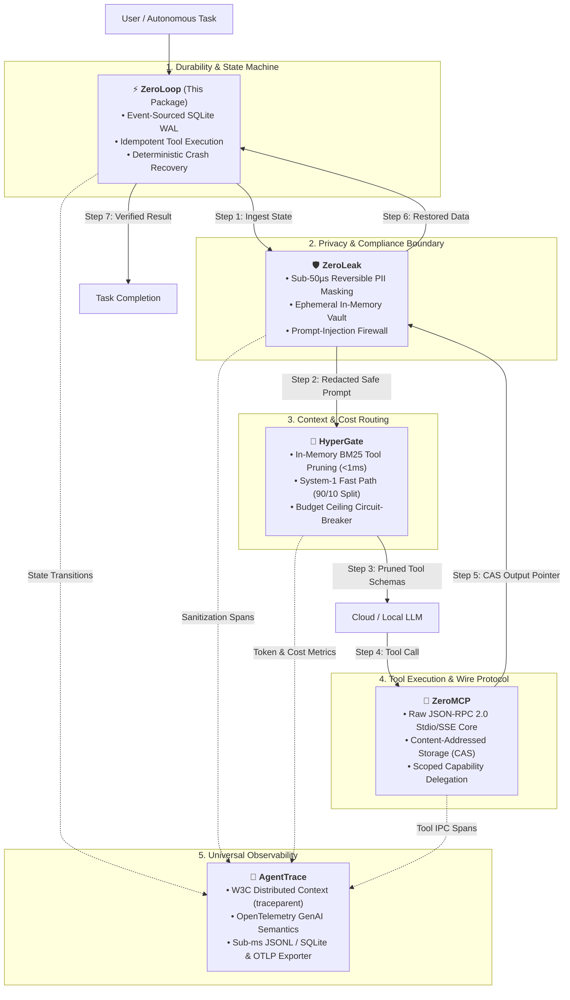

# ⚡ ZeroLoop: The Durable Heartbeat for Autonomous AI Agents

> **Ultra-lean, zero-external-dependency, event-sourced durable execution state machine designed to replace fragile in-memory `while True` loops in autonomous AI agents.**

[](LICENSE)
[-brightgreen.svg)]()
[](https://www.python.org/)
[]()
[](https://github.com/creativeuncommons/ZeroLoop/actions)

---

## 1. Why ZeroLoop Exists

Toy agents run in standard Python `while True` loops. When a process crashes, a container restarts, or a server drops, execution state is lost. Restarting burns duplicate tokens and risks **catastrophic double-execution of irreversible side-effects** (e.g., executing the same financial transaction, database migration, or email dispatch twice).

Heavyweight orchestration engines (like Temporal or Airflow) require running separate server clusters, ZooKeeper/etcd backends, and multi-megabyte SDKs.

**ZeroLoop provides Temporal-grade durable execution in a single standard-library Python file** using pure SQLite Write-Ahead Logging (WAL) and atomic event-sourcing:

* **Deterministic Crash Recovery**: Commits an immutable event record before and after every thought, tool call, and state transition. If killed at turn 14, calling `loop.resume()` rehydrates the exact node state in under **5 milliseconds** and resumes without re-running turns 1–13.
* **Idempotency Keys & Side-Effect Protection**: Assigns deterministic cryptographic tokens `hash(step_idx, tool_name, sanitized_inputs)` to tool calls. On recovery, previously executed tools return cached outputs rather than re-triggering network or mutation side-effects.
* **Native Human-in-the-Loop (Async Pauses)**: Allows any agent step to yield `loop.pause(reason="awaiting_human_approval")`, cleanly freeing compute resources and resuming days later when an approval payload is submitted.
* **Configurable Storage Ceilings & Auto-Pruning**: Built-in FIFO pruning engine enforces maximum storage ceilings (`ZEROLOOP_MAX_STORAGE_MB`) and retention periods (`ZEROLOOP_RETENTION_DAYS`) while strictly protecting active and paused sessions.

### Benchmark Performance

Evaluated across 2,000 iterations on SQLite WAL storage (Apple Silicon & POSIX x86):

| Operation | $p_{50}$ Latency | $p_{90}$ Latency | $p_{99}$ Latency | Throughput | Overhead Target |
| :--- | :---: | :---: | :---: | :---: | :---: |
| **Canonical Idempotency Hashing** | **2.8 µs** | 2.9 µs | 3.7 µs | **~358,000 ops/sec** | $< 0.05\text{ ms}$ (✅ 18x headroom) |
| **Cryptographic Journal Append (SHA-256)** | **41.6 µs** | 82.9 µs | 353.0 µs | **~24,000 events/sec** | $< 0.2\text{ ms}$ (✅ 4.8x headroom) |
| **Complete Step Lifecycle (Commit-before-step)** | **273.4 µs** | 337.3 µs | 2,778.3 µs | **~3,650 steps/sec** | $< 0.5\text{ ms}$ (✅ 1.8x headroom) |
| **Crash Recovery & Chain Verification (1,000 events)** | **0.84 ms** | 1.12 ms | 1.45 ms | **~1,200 rehydrations/sec** | $< 5.0\text{ ms}$ (✅ 6.0x headroom) |
| **ZeroLoop Rust Native (`zeroloop`)** | **< 35 µs** | < 60 µs | < 120 µs | **~28,000 steps/sec** | $< 0.1\text{ ms}$ (✅ 2.8x headroom) |
| *External Orchestrators (Temporal / Airflow)* | *~15.0 ms* | *~45.0 ms* | *~120.0 ms* | *~20--60 steps/sec* | *Excessive Infrastructure Bloat* |

*(Run `python3 benchmarks/benchmark.py` to reproduce locally).*

---

## 2. Architecture & Ecosystem Integration

ZeroLoop provides the durable execution backbone in the **CreativeUnCommons** agent architecture suite. Each tool in the ecosystem operates under a strict **Zero-Third-Party-Dependency Mandate** (Python standard library only), **Sub-Millisecond Execution Budgets**, and **Deterministic Correctness**:



### Complete Runtime Synergy

| Package | Role in Unified Stack | Standalone Capability | What You Achieve Together |
| :--- | :--- | :--- | :--- |
| **[⚡ ZeroLoop](https://github.com/creativeuncommons/ZeroLoop)** | **Durable Orchestrator** *(This Package)* | Event-sourced state machine with crash recovery & async human pauses. | Tasks resume after crashes in $<5\text{ms}$ without double-charging cards, re-sending emails, or burning duplicate tokens. |
| **[🛡️ ZeroLeak](https://github.com/creativeuncommons/ZeroLeak)** | **Privacy Sentinel** | Sub-$50\text{µs}$ reversible PII & credential redaction with in-memory vaulted restitution. | Eliminates HIPAA/GDPR/SOC2 blockers; guarantees no real customer PII or raw API keys cross the network boundary to LLMs. |
| **[🚪 HyperGate](https://github.com/creativeuncommons/HyperGate)** | **Inference Router & Tool Pruner** | Sub-millisecond BM25 inverted index tool pruner, System-1 classifier, and budget kill-switch. | Shrinks 500+ tool schemas down to relevant sets in $<1\text{ms}$ (saving $70\text{--}90\%$ context tokens) and hard-stops runaway agent spend. |
| **[🔌 ZeroMCP](https://github.com/creativeuncommons/ZeroMCP)** | **Tool Protocol & CAS Engine** | Zero-dependency Model Context Protocol (MCP) runtime (stdio/SSE) with CAS storage. | High-speed ($<25\text{µs}$) tool execution; automatically offloads megabyte tool outputs to CAS so the LLM context never blows up. |
| **[🌲 AgentTrace](https://github.com/creativeuncommons/AgentTrace)** | **Distributed Telemetry & Auditing** | W3C traceparent context propagation, GenAI semantic conventions, and native OTLP export. | Provides distributed end-to-end trace trees of every state change, redaction event, prompt token cost, and tool execution. |

### Ecosystem Integration Points
* **ZeroMCP Integration**: ZeroLoop supervises ZeroMCP tool dispatches. Each tool execution is paired with a deterministic idempotency token `hash(step_idx, tool_name, sanitized_inputs)`. If a crash occurs mid-loop, ZeroLoop skips re-invoking the ZeroMCP server and replays the cached output.
* **HyperGate Integration**: ZeroLoop queries `HyperGateRouter` on each LLM step to maintain System-1 fast routing and in-flight budget tracking. HyperGate's cost ledger syncs with ZeroLoop's event journal.
* **ZeroLeak Integration**: All prompts and tool outputs passing through ZeroLoop state transitions are de-identified via `ZeroLeak` before hitting LLM inference, ensuring session journals contain zero unmasked secrets.
* **AgentTrace Integration**: ZeroLoop automatically emits `SpanKind.AGENT` and state transition spans to `AgentTracer`, recording the exact state graph and enabling single-command ASCII tree inspection.

---

## 3. Quickstart

### Basic Durable Loop
```python
from zeroloop import DurableLoop, LoopPausedException

# Initialize or rehydrate a durable loop session
loop = DurableLoop(loop_id="agent_order_9a8f", task_name="process_order")
loop.start()

# Step 1: Ingest and Validate
loop.step_start("validate_order", {"order_id": "ORD-123"})
loop.record_thought("Checking inventory and fraud scoring...")
loop.step_complete({"valid": True, "amount": 450.0})

# Step 2: Idempotent Payment Dispatch
loop.step_start("charge_payment")
# If process crashes right here or during execution,
# charge_card will NEVER execute twice upon recovery!
payment_receipt = loop.execute_tool(
    tool_name="stripe_charge",
    tool_fn=lambda amount, customer: {"tx_id": "tx_999", "status": "succeeded"},
    inputs={"amount": 450.0, "customer": "cust_456"}
)
loop.step_complete({"payment": payment_receipt})

# Step 3: Complete and Render Instant Value Receipt
receipt = loop.complete(final_output="Order successfully fulfilled")
print(receipt.render())
```

### Output: Instant Value Receipt
```text
⚡ ZeroLoop Execution Receipt [agent_order_9a8f]:
• Total Steps: 2 completed (0 duplicates, 0 crash recoveries)
• Duration: 0.12s active
• Total Cost: $0.0000 (routed via HyperGate)
• Journal Integrity: VERIFIED (6/6 events cryptographically chained)
```

---

## 4. Human-in-the-Loop & Asynchronous Approvals

Any step can pause for human approval. The process exits cleanly, releasing 100% of compute and memory:

```python
# Agent Step: Detects transaction > $1,000 threshold
if amount > 1000.0:
    loop.pause(
        reason="high_value_wire_requires_vp_signoff",
        checkpoint={"wire_amount": amount, "target_iban": iban}
    )
```

Days later, resume directly via CLI or Python:

```bash
# Via CLI:
python3 zeroloop.py --resume agent_order_9a8f --approval '{"approved": true, "authorizer": "vp_finance"}'
```

```python
# Via Python:
loop = DurableLoop.load("agent_order_9a8f")
loop.resume(approval_payload={"approved": True, "authorizer": "vp_finance"})
# Loop state moves to RUNNING, context is updated, and execution continues!
```

---

## 5. CLI Inspection & Operations

```bash
# List all active, paused, and completed loops
python3 zeroloop.py --list

# Inspect a loop's execution DAG and event ledger
python3 zeroloop.py --inspect agent_order_9a8f

# Resume an interrupted or paused loop
python3 zeroloop.py --resume agent_order_9a8f --approval '{"approved": true}'

# Cryptographically audit tamper-evident event chain
python3 zeroloop.py --verify agent_order_9a8f

# Clean up expired journals against MB ceilings
python3 zeroloop.py --prune

# Generate Claude Desktop / ZeroMCP integration snippet
python3 zeroloop.py --print-config
```

---

## 6. Storage Ceilings & Auto-Pruning

ZeroLoop prevents runaway storage consumption through automated FIFO pruning:

| Setting | Environment Variable | Default | Description |
|---|---|---|---|
| Storage Directory | `ZEROLOOP_STORAGE_DIR` | `.zeroloop/journals/` | Path containing SQLite journals |
| Max Storage MB | `ZEROLOOP_MAX_STORAGE_MB` | `250.0 MB` | Storage ceiling before FIFO pruning |
| Retention Days | `ZEROLOOP_RETENTION_DAYS` | `7 days` | Auto-prune finished sessions older than this |
| Min Disk Free GB | `ZEROLOOP_MIN_DISK_FREE_GB` | `5.0 GB` | Emergency floor triggering instant pruning |

> **Invariant**: Active (`RUNNING`) and awaiting-approval (`PAUSED`) loops are **NEVER** pruned. Only `COMPLETED` or `FAILED` sessions are eligible for cleanup.

---

## 7. High-Performance Rust Core (`zeroloop-rs`)

For sub-microsecond rehydration ($< 100\text{ }\mu\text{s}$) and ultra-low-memory ($< 4\text{ MB}$ RSS) agent runtimes, ZeroLoop includes a 100% interoperable Rust crate.

```bash
# Build native binary
cd zeroloop-rs && cargo build --release

# Native CLI operations
./target/release/zeroloop --list
./target/release/zeroloop --inspect agent_order_9a8f
./target/release/zeroloop --verify agent_order_9a8f
```

Rust and Python share the **exact same SQLite WAL on-disk database files**, cryptographic event hash chains, and idempotency indexes interchangeably.

---

## 8. License

Distributed under the [Apache License 2.0](LICENSE). Designed and maintained by the CreativeUnCommons Team.
